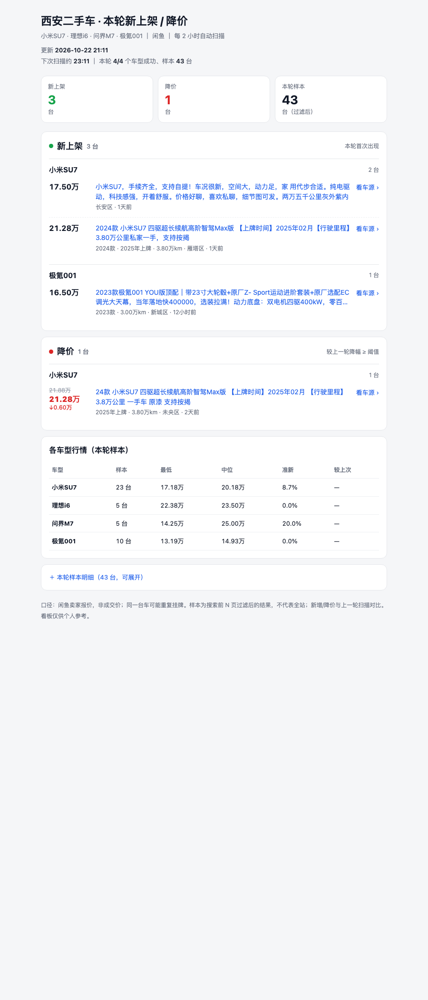

# dsh-vehicle-watch

[](https://github.com/judyding1121-web/dsh-vehicle-watch/actions/workflows/ci.yml)
[](LICENSE)
[](https://github.com/judyding1121-web/dsh-vehicle-watch)

> GitHub: https://github.com/judyding1121-web/dsh-vehicle-watch

DeepSeek Harness（DSH）Host 插件 / Cordis bundle：监控**西安** **小米SU7 / 理想i6 / 问界M7 / 极氪001** 的**闲鱼**二手车，新上架或降价时推送到企业微信、飞书，并生成 **Excel 报表 + 单文件 HTML 看板**。

- 每 2 小时按关键词搜索闲鱼（按发布时间倒序，第 1 页 30 条/关键词，可配多页）；
- 只保留**西安**、**二手车类目**、匹配关键词的车源，过滤配件/用品/租车/事故残值车；
- 与已见 `listing_id` 对比：**新上架**、**已跟踪车源降价**；
- 有新变化才推；企业微信用模板卡片，整卡可点跳**闲鱼商品页**；首次启动只发一条基线摘要；
- 生成 `二手车监控-最新.xlsx`（6 个 sheet）、CSV，以及 `二手车监控-最新.html`（只讲**本轮新上架/降价**的简洁看板，电脑/手机浏览器都能看）；
- 可选企业微信「智能机器人」双向指令（查行情 / 最新 / 找车型 / 扫描）。

> 卖家报价 ≠ 成交价；闲鱼是 C2C 平台，同一台车可能重复挂牌或由车商发布；样本 = 每次搜索前 N 页过滤后的结果。仅个人低频自用，不商用、不公开分发数据。

---

## 环境要求

| 项 | 要求 | 说明 |
|---|---|---|
| DSH Desktop | **0.2.1-rc.2** | `peerDependencies` 钉死此版本；其他版本需版本豁免（见下） |
| Node.js | ≥ 24 | DSH 自带，无需另装 |
| Python 3 + `openpyxl` | 可选 | 仅生成 Excel 需要；不装可设 `report.enabled: false`，仍输出 CSV |
| 企业微信群机器人 webhook | 可选 | 不填则只落库/出表，不推送 |
| 飞书群机器人 webhook | 可选 | 同上 |
| 企业微信智能机器人 `botId`/`secret` | 可选 | 只有要双向指令时才需要 |
| 闲鱼登录 Cookie | 可选 | 匿名也能搜索；触发风控（RGV587）时填上更稳 |

---

## 安装

### 方式 A：从 GitHub 安装（推荐，另一台电脑最省事）

插件管理器直接把 GitHub 仓库当 npm spec 安装，依赖（`ws`）会自动装好。

1. DSH → Web 侧栏 → **插件** → **添加插件** → **安装第三方插件**；
2. 输入仓库 spec，二选一：
   - `github:judyding1121-web/dsh-vehicle-watch`
   - `https://github.com/judyding1121-web/dsh-vehicle-watch`
3. 安装完成后确认状态是 `applied`（若提示 `restart-required`，重启 DSH）；
4. 按下面「配置」填写 webhook / 车型；
5. 30 秒后自动首扫，或让 Agent 调用 `vehicle_usedcar_scan`。

> 也可以让 Agent 调用 `plugin_manager`：`action: install_bundle`、`target: 'github:judyding1121-web/dsh-vehicle-watch'`。该工具需要 `danger-full-access` 或本次调用审批。
>
> 私有仓库：需要本机 Git 凭据（SSH key 或 credential helper/token）。安装前管理器会用 `git ls-remote` 探活，认证失败会继续交给 pnpm，能凭据就绪即可。

### 方式 B：clone 后按本地目录安装

适合改代码 / 离线：

```bash
git clone https://github.com/judyding1121-web/dsh-vehicle-watch.git
cd dsh-vehicle-watch
pnpm install        # 本地 link 安装不会替你装 ws，必须手动执行一次
```

然后：插件 → 添加插件 → 安装第三方插件 → 选这个目录的**绝对路径**。

### 方式 C：离线 tarball

```bash
pnpm pack           # 生成 dsh-vehicle-watch-0.3.0.tgz
```

把 `.tgz` 拷到另一台电脑，安装时填 tarball 的绝对路径（同样支持）。

> ⚠️ Desktop 的 profile 由 Electron 独占管理：**不要**手改 `~/.dsh/profiles/desktop/package.json` / `cordis.yml`，也**不要**用 `dsh plugin` CLI 改 desktop profile。只改 `cordis.patch.yml`。

---

## 配置

安装后编辑 `~/.dsh/profiles/desktop/cordis.patch.yml`，在 `- id: vehicle-watch` 下填配置（可复制本仓库 [`cordis.patch.yml`](cordis.patch.yml) 的 `config` 再改）。

```yaml
- id: vehicle-watch
  config:
    city: 西安
    province: 陕西
    minPriceYuan: 30000          # 低于此价视为配件/租车/残值车
    carCategoryId: '127302001'   # 闲鱼「二手车」类目 id（一般不用改）
    scanIntervalHours: 2
    startupDelaySec: 30
    maxPushPerRun: 8
    notifyOnFirstRun: true
    priceDropAbs: 1000
    excludeKeywords: [租车, 日租, 床垫, 车模, 配件, 订单, 返现, 定金, 事故, 水淹, 残值, 批发]
    targets:
      - id: xiaomi-su7
        name: 小米SU7
        keyword: 小米SU7
        referenceOfficialLow: 219900
        referenceOfficialHigh: 303900
        enabled: true
      # 其余车型照抄 cordis.patch.yml
    dashboard:
      enabled: true              # 内置只读 HTTP 看板（手机同一 Wi-Fi 可看）
      port: 47800
      host: ''                   # 空 = 0.0.0.0；只在本机看可填 127.0.0.1
    xianyu:
      cookie: ''                 # 可选：填闲鱼网页登录 Cookie（document.cookie 整串）
      pages: 1                   # 每个关键词翻几页（每页 30 条）
      minGapMs: 3000             # 请求间隔，太低容易触发风控
      timeoutMs: 20000
    notify:
      wecomWebhook: 'https://qyapi.weixin.qq.com/cgi-bin/webhook/send?key=...'
      feishuWebhook: 'https://open.feishu.cn/open-apis/bot/v2/hook/...'
      feishuSecret: ''
      timeoutMs: 10000
    aibot:                       # 双向指令才需要；不需要就整段留空/删掉
      enabled: false
      botId: ''
      secret: ''
    report:
      enabled: true
      html: true                 # 每次扫描后生成单文件 HTML 看板
      dir: ''                    # 空 = ~/.dsh/storages/vehicle-watch/reports
      pythonPath: python3        # 换机器一般不用改；Windows 填 python
      keepDays: 30
```

**注意：`config` 是整体替换，不是深合并。** 覆盖时必须重述 `targets`、`notify`、`report` 等所有字段（可整段复制仓库里的 `cordis.patch.yml` 再改）。webhook / bot secret / 闲鱼 Cookie 都是凭证，`cordis.patch.yml` 权限建议 `600`，**不要提交到仓库、不要贴进对话**。

常用字段：

| 字段 | 默认 | 说明 |
|---|---|---|
| `city` / `province` | 西安 / 陕西 | 闲鱼搜索结果的城市过滤（division） |
| `minPriceYuan` | 30000 | 价格下限，过滤配件/租车/残值车 |
| `carCategoryId` | 127302001 | 闲鱼二手车类目 id；先按类目过滤再匹配关键词 |
| `excludeKeywords` | 见上 | 标题命中即剔除的非车/事故词 |
| `scanIntervalHours` | 2 | 扫描间隔（小时） |
| `startupDelaySec` | 30 | 启动后首扫延迟，避免抢启动 |
| `maxPushPerRun` | 8 | 单条消息最多列几台，超出提示看 Excel |
| `priceDropAbs` | 1000 | 降价超过多少元才推 |
| `notifyOnFirstRun` | true | 首次只建基线，不逐条推 |
| `xianyu.pages` | 1 | 每个关键词翻页数（每页 30 条） |
| `xianyu.cookie` | `''` | 可选登录 Cookie；触发风控时可提高稳定性 |
| `report.html` | true | 每次扫描后生成 `二手车监控-最新.html` 看板（不依赖 Python；关掉也不影响推送/Excel） |
| `dashboard.enabled` | true | 内置只读 HTTP 看板服务（手机同一 Wi-Fi 可访问；只读、无鉴权，别暴露公网） |
| `dashboard.port` | 47800 | 端口；被占用时自动 +1 重试 |
| `dashboard.host` | `''` | 空 = 0.0.0.0（局域网可访问）；只在本机看填 `127.0.0.1` |
| `report.dir` | `''` | 空 = `~/.dsh/storages/vehicle-watch/reports`；可指向工作区 |
| `report.pythonPath` | `python3` | 换机器一般不用改 |

### 闲鱼 Cookie 怎么填（可选）

1. 浏览器登录 `https://www.goofish.com/`；
2. 打开开发者工具 → Console，执行 `document.cookie`，复制整串；
3. 填到 `xianyu.cookie: '...'`，重启插件生效。

Cookie 会过期，失效后插件会自动退回匿名搜索；若频繁被风控，重新取一次即可。

---

## 数据与状态

| 内容 | 位置 |
|---|---|
| 已见车源 / 去重状态 | `~/.dsh/storages/vehicle-watch/used-car-state.json` |
| 报表与明细 | `report.dir`（默认 `~/.dsh/storages/vehicle-watch/reports`） |
| 产物 | `二手车监控-最新.xlsx`、`二手车监控-最新.html`、`latest.json`、`latest.csv`、`listings-latest.csv`、`scan-log.jsonl` |

### HTML 看板（本轮新上架 / 降价，手机可看）



每次扫描后自动重写 `二手车监控-最新.html`。页面只回答两件事：**本轮有哪些新上架、哪些车降价**；全量车源收在底部「本轮样本明细（可展开）」，默认不铺开。

- 顶部：更新时间、下次扫描时间、本轮成功车型数/样本数，以及「新上架 / 降价 / 样本」三个大数字；
- 「新上架」按车型分组：价格、标题、年款/里程/地区/发布时间，点「看车源」跳闲鱼；
- 「降价」：原价 → 现价、降幅；
- 没有变化时直接显示「本轮没有新上架，也没有降价」；
- 底部一行：各车型样本/最低/中位/准新/较上次，快速看行情。

**手机查看（同一 Wi-Fi）**：插件内置只读 HTTP 服务，默认端口 `47800`。

- 在最方便的地方发 **`看板`**（企微机器人），机器人会直接回复看板链接；
- 或让 Agent 调 `vehicle_usedcar_status`，返回 `dashboard.url`；
- 地址形如 `http://192.168.x.x:47800/`；每轮扫描后自动更新，手机下拉刷新即可。

> 只监听局域网、只读、无鉴权：不要暴露到公网；macOS 首次可能弹「允许传入连接」，允许即可。端口被占用会自动 +1 重试。

也可手动重生成（用现有 latest.json）：

```bash
node scripts/make_html.mjs <latest.json> [out.html] [intervalHours]
```

状态与报表都**不在仓库里**，换电脑互不影响；首次运行会重新建立基线。**从瓜子版升级**时，第一次闲鱼扫描会自动按“基线”处理，不会把全量当新上架刷屏。

---

## 工具

| 工具 | 用途 |
|---|---|
| `vehicle_usedcar_scan` | 立即搜索一次闲鱼（可指定 `targetId`）；返回新增/降价/消息/报表与看板路径 |
| `vehicle_usedcar_status` | 上次扫描、各车型样本数/中位价/已见数、闲鱼关键词与搜索链接、看板路径 |
| `vehicle_usedcar_bot_status` | 企微智能机器人连接状态、收发计数 |
| `vehicle_usedcar_report` | 用最近一次结果重新生成 Excel + HTML 看板 |

## 企业微信双向指令

在群里 **@机器人** 发送：

| 指令 | 回复 |
|---|---|
| `查` / `行情` / `状态` | 各车型样本数、中位价 |
| `小米SU7` / `理想i6` / `问界M7` / `极氪001` | 该车型行情 + 最低价 3 台 |
| `最新` / `新上架` | 本轮新增车源 |
| `扫描` / `刷新` | 立即抓取一次 |
| `找宋L` / `找理想L9` | 临时查询闲鱼，并问是否加入监控 |
| `看板` | 回复本轮变化看板的局域网链接（手机直接点开） |
| `取消` / `帮助` | 取消加入询问 / 指令列表 |

---

## 换电脑 / 升级 DSH 后

- **DSH 版本不同**：安装可能报 `incompatible-version`（peer 依赖钉 `0.2.1-rc.2`）。处理：插件页 → 版本豁免（或让 Agent 用 `plugin_manager` 的 `set_version_exemption`，需 `acceptRisk: true`），只对该 `包@版本 + DSH 版本` 组合生效。
- **升级插件**：可 HMR 的改动即时生效；替换已装包通常提示 `restart-required`，重启即可。
- **卸载**：插件页移除；状态文件保留在 `~/.dsh/storages/vehicle-watch/`，需要彻底清理时手动删。

## 常见问题

| 现象 | 处理 |
|---|---|
| 安装后工具不出现 | 看是否 `applied`；`restart-required` 就重启；日志找 `vehicle-watch mounted` |
| 报 `Cannot find package 'ws'` | 本地目录安装没跑 `pnpm install`；执行一次后重启 |
| 扫描报 `RGV587` / “被挤爆啦” | 触发闲鱼风控：调大 `xianyu.minGapMs`、减少 `pages`、稍后重试；长期需要可在 `xianyu.cookie` 填登录 Cookie |
| 样本数为 0 | 关键词无整车结果/被风控/类目或价格过滤太严；看日志与 `scan-log.jsonl` |
| 首轮没推送 | 首次只建基线；或 webhook 为空（日志 `notify skipped`） |
| 报表失败 `No module named openpyxl` | `python3 -m pip install --user openpyxl`，或 `report.enabled: false`（CSV 与 HTML 看板照常生成） |
| 看板怎么打开 | 电脑：双击/浏览器打开 `report.dir/二手车监控-最新.html`；手机：与 Mac 同一 Wi-Fi，发「看板」拿 `http://<局域网IP>:47800/` 链接 |
| 手机打不开看板 | 确认同一 Wi-Fi、Mac 防火墙允许传入连接、端口未被占用；地址用局域网 IP（不是 127.0.0.1），日志搜 `dashboard ready` |
| DSH 关闭后不跑 | 本插件随 DSH Host 生命周期；要 7×24 需另加 launchd / 常驻服务 |

---

## 开发

```bash
pnpm install                  # 只装 ws；@deepseek-ai/* 由 DSH 运行时提供
pnpm run check                # 所有入口语法检查
pnpm test                     # 自测：命令处理器 + 闲鱼解析/过滤，全部离线（fixture）
```

CI（GitHub Actions，`.github/workflows/ci.yml`）在每次 push / PR 时执行：
`pnpm install --frozen-lockfile` → `pnpm run check` → `pnpm test` → `pnpm pack` 冒烟。

---

## 发布到 GitHub（维护者）

**本目录就是仓库根**：`package.json` 在根、声明了 `dsh.bundle.patch`，插件管理器才能把它当 bundle 安装。不要把整个 workspace 当仓库发（bundle 在子目录，安装时无法指向子目录）。

```bash
cd plugins/dsh-vehicle-watch
git init -b main
git add .
git commit -m "feat: dsh-vehicle-watch v0.3.0"

# 有 gh CLI：
gh repo create dsh-vehicle-watch --public --source=. --push
# 或网页建空仓库后：
git remote add origin https://github.com/judyding1121-web/dsh-vehicle-watch.git
git push -u origin main
```

发布前检查：

1. `pnpm run check`、`pnpm test` 通过；
2. 仓库里**没有** webhook、bot secret、闲鱼 Cookie、`node_modules/`、`data/`、`*.xlsx`、`*.csv`、`scan-log.jsonl`（`.gitignore` 已覆盖，仍建议 `git status` 过一眼）；
3. `cordis.patch.yml` 里没有绝对路径；
4. 只发布代码，不发布抓取到的车源数据。

## 合规

- 闲鱼卖家报价 ≠ 成交价；样本 = 搜索结果过滤后的车源，不承诺全量。
- 默认 2 小时 × 4 关键词 × 1 页 ≈ 48 请求/天；请保持低频，遵守目标站点条款，不商用、不公开分发数据。
- 闲鱼有登录/风控限制，本插件只做个人低频查询，不破解验证码、不绕过登录。
- 插件运行在 DSH Host 进程内、拥有宿主权限；安装第三方插件前先读代码。

## License

[MIT](LICENSE)
